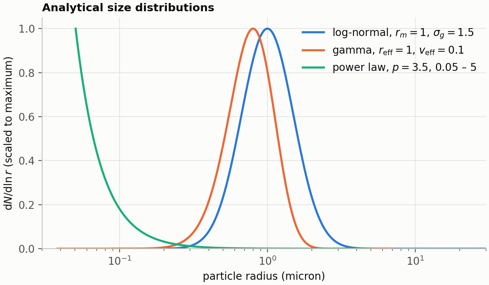
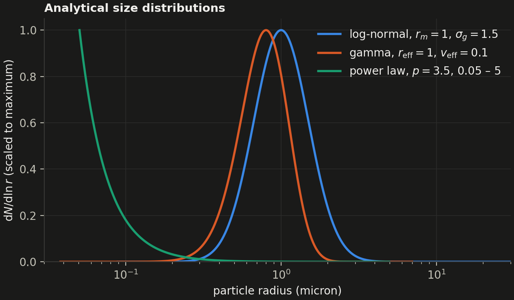

Particle size distributions
===========================

In most applications, particles are not of a single size, but follow a size
distribution :math:`n(r) = \mathrm{d}N / \mathrm{d}r`, where
:math:`n(r) \, \mathrm{d}r` is the number of particles with radii between
:math:`r` and :math:`r + \mathrm{d}r`. LX-MIE can integrate all optical
properties over such a distribution. This page describes the available
distributions, the calculated quantities, and the numerical integration. The
corresponding interfaces are documented in

- :doc:`../python/api` for the Python package,
- :ref:`cli-size-distributions` for the command-line tool,
- :doc:`../cpp/api` for the C++ library.

.. _size-integrated-quantities:

Size-integrated quantities
--------------------------

In the following, angle brackets denote the average over the size
distribution,

.. math::

   \langle f \rangle = \frac{\int f(r) \, n(r) \, \mathrm{d}r}{\int n(r) \, \mathrm{d}r} \ .

For a size distribution, LX-MIE calculates:

**Mean cross sections per particle**

.. math::

   \langle C \rangle = \frac{\int C(r) \, n(r) \, \mathrm{d}r}{\int n(r) \, \mathrm{d}r} \ ,
   \qquad C(r) = Q(r) \, \pi r^2 \ ,

for extinction, scattering, and absorption.

**Mean geometric cross section and effective radius**

.. math::

   \langle G \rangle = \langle \pi r^2 \rangle \ , \qquad
   r_\mathrm{eff} = \frac{\langle r^3 \rangle}{\langle r^2 \rangle} \ .

**Effective efficiencies**

.. math::

   Q_\mathrm{eff} = \frac{\langle C \rangle}{\langle \pi r^2 \rangle} \ .

**Asymmetry parameter, phase function, and Legendre coefficients.** These
quantities are averaged with the scattering cross sections as weights, e.g.

.. math::

   g = \frac{\int g(r) \, C_\mathrm{sca}(r) \, n(r) \, \mathrm{d}r}
            {\int C_\mathrm{sca}(r) \, n(r) \, \mathrm{d}r} \ ,
   \qquad
   p(\mu) = \frac{\int p(\mu, r) \, C_\mathrm{sca}(r) \, n(r) \, \mathrm{d}r}
                 {\int C_\mathrm{sca}(r) \, n(r) \, \mathrm{d}r} \ .

The size-averaged phase function and its Legendre series have the same
normalisation as those of a single particle (see :doc:`../conventions`). In
particular, the second Legendre coefficient is equal to the asymmetry
parameter of the distribution.

Since all quantities are ratios of integrals over the distribution, the
**normalisation of** :math:`n(r)` **is irrelevant**.

From mean cross sections to opacities
~~~~~~~~~~~~~~~~~~~~~~~~~~~~~~~~~~~~~

Multiplying the mean cross sections by the total number density
:math:`N_\mathrm{tot}` of the particles yields the extinction, scattering,
and absorption coefficients,

.. math::

   \kappa_\mathrm{ext} = N_\mathrm{tot} \, \langle C_\mathrm{ext} \rangle \ .

The single scattering albedo of the distribution is
:math:`\omega_0 = \langle C_\mathrm{sca} \rangle / \langle C_\mathrm{ext} \rangle`.

Available distributions
-----------------------

   Examples of the three analytical size distributions, shown as the number
   of particles per logarithmic radius interval. The curves cover the radius
   ranges that are chosen automatically by LX-MIE.

   Examples of the three analytical size distributions, shown as the number
   of particles per logarithmic radius interval. The curves cover the radius
   ranges that are chosen automatically by LX-MIE.

Log-normal distribution
~~~~~~~~~~~~~~~~~~~~~~~

.. math::

   n(r) \propto \frac{1}{r} \exp \left( - \frac{\ln^2 (r / r_m)}{2 \ln^2 \sigma_g} \right)

The parameters are the median radius :math:`r_m` and the geometric standard
deviation :math:`\sigma_g > 1`. The effective radius of the distribution is

.. math::

   r_\mathrm{eff} = r_m \exp \left( \frac{5}{2} \ln^2 \sigma_g \right) \ .

.. note::

   The width of a log-normal distribution is sometimes also specified by
   :math:`\sigma = \ln \sigma_g`. LX-MIE expects the geometric standard
   deviation :math:`\sigma_g = \mathrm{e}^{\sigma}`, which is always larger
   than one.

Gamma distribution
~~~~~~~~~~~~~~~~~~

.. math::

   n(r) \propto r^{(1-3b)/b} \exp \left( - \frac{r}{ab} \right)

This is the gamma distribution in the form of Hansen & Travis [HT74]_. Its
two parameters directly correspond to the effective radius
:math:`a = r_\mathrm{eff}` and the effective variance
:math:`b = v_\mathrm{eff}` of the distribution, with :math:`0 < b < 0.5`.

Power law
~~~~~~~~~

.. math::

   n(r) \propto r^{-p} \ , \qquad r_\mathrm{min} \leq r \leq r_\mathrm{max}

The parameters are the smallest and largest radius, and the exponent
:math:`p`. A well-known example is the size distribution of interstellar
dust grains by Mathis, Rumpl & Nordsieck (1977) with :math:`p = 3.5`.

Tabulated distribution
~~~~~~~~~~~~~~~~~~~~~~

An arbitrary distribution can be given by the values of
:math:`n(r) = \mathrm{d}N/\mathrm{d}r` at a set of strictly increasing radii.
Between the tabulated radii, the integrands are assumed to be linear, i.e.
the distribution is integrated with the trapezoidal rule. The table therefore
has to resolve the distribution sufficiently well.

Discrete size bins
~~~~~~~~~~~~~~~~~~

In the Python package and the C++ library, a distribution can also be defined
directly by a list of radii and the number of particles for each radius. This
is the appropriate choice for the discrete size bins of a cloud or haze
model. In this case, the integrals above turn into sums over the bins,

.. math::

   \langle C \rangle = \frac{\sum_i w_i \, C(r_i)}{\sum_i w_i} \ ,

with the particle numbers (or number densities) :math:`w_i`.

.. important::

   The weights of discrete size bins are particle *numbers*, whereas a
   tabulated distribution contains the values of the *density*
   :math:`\mathrm{d}N/\mathrm{d}r`. Using particle numbers per bin as a
   tabulated distribution gives incorrect results if the bins do not all
   have the same width.

Numerical integration
---------------------

Internally, every size distribution is represented by a set of radii
:math:`r_i` and weights :math:`w_i = n(r_i) \, \Delta r_i`. One Mie
calculation is performed for each radius, and the integrals over the
distribution are replaced by sums.

Radius grid
~~~~~~~~~~~

For the three analytical distributions, the radii are distributed
equidistantly in :math:`\ln r` and the integrals are evaluated with the
trapezoidal rule. The number of radii is 500 by default and can be changed
by the user.

Integration limits
~~~~~~~~~~~~~~~~~~

The log-normal and the gamma distribution formally extend from zero to
infinity. Their integration limits are chosen automatically, such that they
cover

- the distribution itself, which is required for its normalisation, and
- the distribution weighted with :math:`r^6`. This is the steepest possible
  size dependence of a cross section (scattering in the Rayleigh limit) and
  ensures that the contribution of the large particles is included.

For the log-normal distribution, the grid extends from

.. math::

   r_m \exp \left( - 6 \ln \sigma_g \right)
   \qquad \text{to} \qquad
   r_m \exp \left( 6 \ln^2 \sigma_g + 6 \ln \sigma_g \right) \ ,

i.e. from six standard deviations below the median of :math:`n(r)` to six
standard deviations above the maximum of :math:`r^6 n(r)`. For the gamma
distribution, the lower limit is chosen such that the neglected fraction of
the total particle number is about :math:`10^{-8}`. The upper limit is
located far in the exponential tail of :math:`r^6 n(r)`.

.. list-table:: Examples of the automatic integration limits
   :header-rows: 1
   :widths: 50 25 25

   * - Distribution
     - Smallest radius
     - Largest radius
   * - Log-normal, :math:`r_m = 1`, :math:`\sigma_g = 1.5`
     - 0.088
     - 30.5
   * - Gamma, :math:`r_\mathrm{eff} = 1`, :math:`v_\mathrm{eff} = 0.1`
     - 0.038
     - 7.04

In the Python package and the C++ library, the limits can be set explicitly
with the parameters ``r_min`` and ``r_max``. This truncates the distribution
at these radii.

.. note::

   Due to the weighting with :math:`r^6`, the upper limit of a broad
   log-normal distribution can be very large. For :math:`\sigma_g = 3`, for
   example, it is about :math:`10^6 \, r_m`. Since the computing time of a
   Mie calculation increases with the particle size, calculations for very
   broad distributions at short wavelengths can take considerably longer. If
   the large particles are known to be irrelevant, the distribution can be
   truncated with ``r_max``.

Accuracy
~~~~~~~~

The Mie efficiencies of weakly absorbing particles oscillate rapidly as a
function of the particle size (see the figure on the :doc:`start page
<../index>`). The integration over the size distribution has to resolve these
oscillations. The accuracy therefore depends on the number of radii, the
width of the distribution, the ratio of the particle sizes to the
wavelength, and the absorption of the material.

The following table shows the relative errors of the mean extinction cross
section for a log-normal distribution with :math:`r_m = 1`, :math:`\sigma_g
= 1.5`, and a real part of the refractive index of 1.5 at a wavelength of
0.55, as a function of the number of radii:

.. list-table::
   :header-rows: 1
   :widths: 28 36 36

   * - Number of radii
     - :math:`k = 0`
     - :math:`k = 0.01`
   * - 100
     - :math:`1 \times 10^{-2}`
     - :math:`4 \times 10^{-3}`
   * - 500 (default)
     - :math:`2 \times 10^{-3}`
     - :math:`9 \times 10^{-5}`
   * - 2000
     - :math:`3 \times 10^{-4}`
     - :math:`< 10^{-9}`
   * - 10000
     - :math:`7 \times 10^{-5}`
     - :math:`< 10^{-9}`

As a rule of thumb, the size-integrated quantities are accurate to about
:math:`10^{-4}` – :math:`10^{-3}` with the default number of 500 radii. The
largest errors occur for non-absorbing particles that are large compared to
the wavelength. Absorption damps the oscillations and strongly improves the
convergence. For higher accuracy or very broad distributions, the number of
radii can be increased. The computing time is proportional to the number of
radii.

References
----------

.. [HT74] Hansen, J. E. & Travis, L. D. (1974), *Light scattering in
   planetary atmospheres*, Space Science Reviews 16, 527–610
