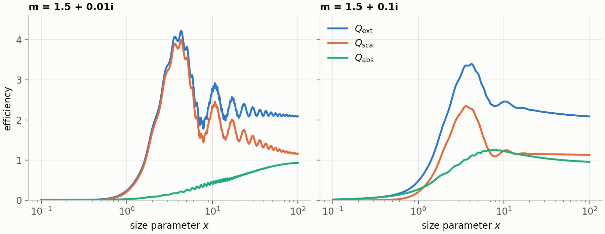
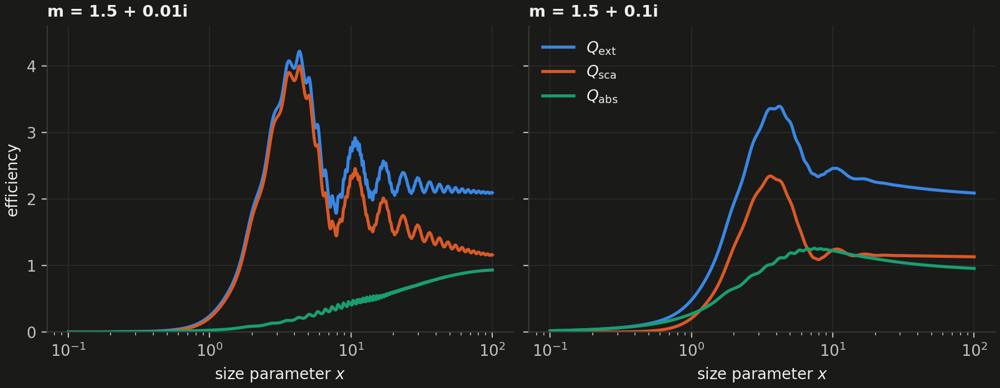

LX-MIE
======

LX-MIE is a fast and numerically stable Mie scattering code for homogeneous
spheres. It is optimised for arbitrarily large size parameters and has been
tested up to :math:`x = 10^9`. The numerical method is described in
`Kitzmann & Heng (2018) <https://arxiv.org/abs/1710.04946>`_.

LX-MIE calculates

- extinction, scattering, and absorption efficiencies or cross sections,
- the asymmetry parameter,
- the scattering phase function at arbitrary angles,
- the Legendre series representation of the phase function,
- all of the above for a single particle size or integrated over a particle
  size distribution.

The code is written in C++17 and can be used in three different ways:

.. list-table::
   :widths: 28 72

   * - :doc:`Python package <python/index>`
     - ``pip install lxmie``. Scalar and OpenMP-parallel batch functions for
       all quantities listed above.
   * - :doc:`Command-line tool <cli/index>`
     - The executable ``lx_mie`` reads a parameter file and a table of
       refractive indices and writes the results to text files.
   * - :doc:`C++ library <cpp/index>`
     - Two header files and a small static library that can be linked into
       other C++ codes.

LX-MIE also includes a :doc:`compilation of optical constants
<background/refractive_indices>` for 32 condensate species relevant to
planetary and exoplanetary atmospheres.

   Extinction, scattering, and absorption efficiencies calculated with
   LX-MIE for a weakly and a strongly absorbing sphere.

   Extinction, scattering, and absorption efficiencies calculated with
   LX-MIE for a weakly and a strongly absorbing sphere.

If you use LX-MIE in your work, please :doc:`cite <citing>` Kitzmann & Heng
(2018).

.. toctree::
   :caption: Getting started
   :hidden:

   installation
   quickstart
   conventions

.. toctree::
   :caption: Python package
   :hidden:

   python/index
   python/api
   python/examples

.. toctree::
   :caption: Command-line tool
   :hidden:

   cli/index
   cli/parameter_file
   cli/output_files

.. toctree::
   :caption: C++ library
   :hidden:

   cpp/index
   cpp/api

.. toctree::
   :caption: Background
   :hidden:

   background/theory
   background/size_distributions
   background/refractive_indices
   background/performance

.. toctree::
   :caption: About
   :hidden:

   troubleshooting
   citing
   license
