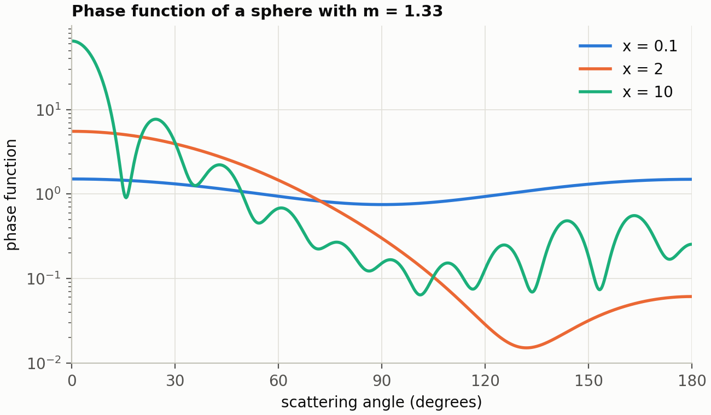
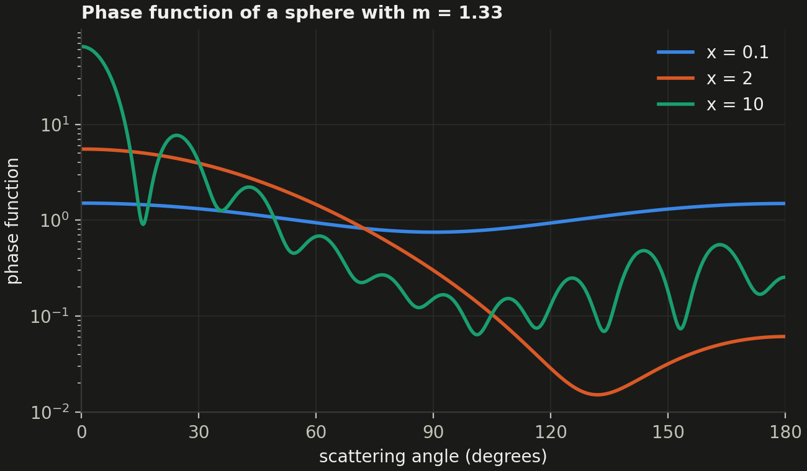
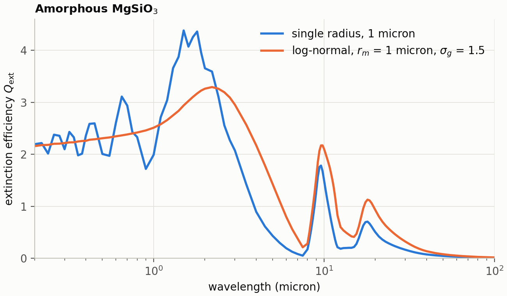
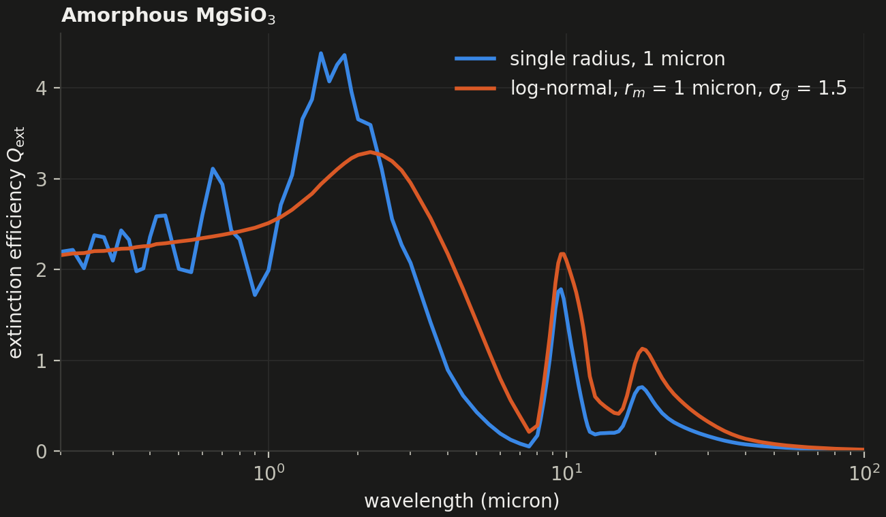

Examples
========

Example scripts
---------------

The ``examples/`` directory of the repository contains four scripts that
demonstrate common workflows. They read the refractive indices from the
``compilation/`` directory and therefore have to be run from the root
directory of the repository:

.. code-block:: bash

   python examples/example_efficiencies.py
   python examples/example_legendre.py
   python examples/example_phase_function.py
   python examples/example_size_distribution.py

.. list-table::
   :header-rows: 1
   :widths: 38 62

   * - Script
     - Content
   * - ``example_efficiencies.py``
     - Reads ``compilation/Cr.dat`` and calculates efficiencies and cross
       sections for all 273 wavelengths in a single parallel batch call.
   * - ``example_legendre.py``
     - Legendre series coefficients of the phase function, for a single
       wavelength and as a batch calculation.
   * - ``example_phase_function.py``
     - Phase function at 37 angles between 0° and 180°. Demonstrates the
       conversion from degrees to cosines and the normalisation of the
       scattering amplitudes with :func:`lxmie.phase_function`.
   * - ``example_size_distribution.py``
     - Cross sections integrated over a log-normal size distribution for all
       wavelengths of ``compilation/MgSiO3_amorph_glass.dat``, as well as the
       size-averaged phase function and its Legendre series.

The following sections contain additional, self-contained recipes.

Reading a refractive index file
-------------------------------

The files of the :doc:`compilation <../background/refractive_indices>` have
three header lines starting with ``#`` and three data columns. They can be
read with a few lines of Python,

.. code-block:: python

   def read_refractive_index(path):
       wavelengths, n_real, n_imag = [], [], []

       with open(path) as f:
           for line in f:
               line = line.strip()
               if not line or line.startswith("#"):
                   continue
               wl, n, k = line.split()[:3]
               wavelengths.append(float(wl))
               n_real.append(float(n))
               n_imag.append(float(k))

       return wavelengths, n_real, n_imag

or with NumPy:

.. code-block:: python

   import numpy as np

   wavelengths, n_real, n_imag = np.loadtxt("compilation/Cr.dat", unpack=True)

Efficiencies as a function of the size parameter
------------------------------------------------

.. code-block:: python

   import numpy as np
   import matplotlib.pyplot as plt
   import lxmie

   x = np.logspace(-1, 2, 3000)
   results = lxmie.mie([1.5] * len(x), [0.01] * len(x), x)

   plt.plot(x, [r.q_ext for r in results], label="extinction")
   plt.plot(x, [r.q_sca for r in results], label="scattering")
   plt.plot(x, [r.q_abs for r in results], label="absorption")
   plt.xscale("log")
   plt.xlabel("size parameter")
   plt.ylabel("efficiency")
   plt.legend()
   plt.show()

Cross sections and opacities
----------------------------

The efficiencies are converted to cross sections with the geometric cross
section of the particle. With the mass of a particle, this yields the opacity
per unit mass of the condensate:

.. code-block:: python

   import math
   import lxmie

   wavelengths, n_real, n_imag = read_refractive_index("compilation/MgSiO3_amorph_glass.dat")

   radius = 0.1e-4    # particle radius in cm (0.1 micron)
   density = 3.2      # density of the particle material in g cm^-3 (example value)

   x = [2.0 * math.pi * radius / (wl * 1e-4) for wl in wavelengths]
   results = lxmie.mie(n_real, n_imag, x)

   area = math.pi * radius**2                         # cm^2
   mass = 4.0 / 3.0 * math.pi * radius**3 * density   # g

   c_ext = [r.q_ext * area for r in results]          # cm^2 per particle
   kappa_ext = [c / mass for c in c_ext]              # cm^2 per g of condensate

Phase function
--------------

.. code-block:: python

   import numpy as np
   import matplotlib.pyplot as plt
   import lxmie

   angles = np.linspace(0.0, 180.0, 721)
   cos_angles = np.cos(np.radians(angles))

   for x in [0.1, 2.0, 10.0]:
       result, s1, s2 = lxmie.mie_amplitudes(1.33, 0.0, x, cos_angles)
       p = lxmie.phase_function(s1, s2, x, result.q_sca)

       plt.plot(angles, p, label=f"x = {x}")

   plt.yscale("log")
   plt.xlabel("scattering angle (degrees)")
   plt.ylabel("phase function")
   plt.legend()
   plt.show()

   Result of the example above. For small size parameters, the phase function
   approaches the one of Rayleigh scattering. With increasing size parameter,
   a strong forward-scattering peak develops.

   Result of the example above. For small size parameters, the phase function
   approaches the one of Rayleigh scattering. With increasing size parameter,
   a strong forward-scattering peak develops.

Degree of linear polarisation
-----------------------------

The scattering amplitudes contain the full information on the scattered
light. As an example, the degree of linear polarisation for unpolarised
incident light is given by
:math:`P = (|S_1|^2 - |S_2|^2) / (|S_1|^2 + |S_2|^2)`:

.. code-block:: python

   result, s1, s2 = lxmie.mie_amplitudes(1.33, 0.0, 10.0, cos_angles)

   i1 = np.abs(np.array(s1))**2
   i2 = np.abs(np.array(s2))**2

   polarisation = (i1 - i2) / (i1 + i2)

Reconstructing the phase function from its Legendre series
----------------------------------------------------------

.. code-block:: python

   import numpy as np
   from numpy.polynomial import legendre
   import lxmie

   x = 5.0
   nb_moments = 60

   result, moments = lxmie.mie_legendre(1.5, 0.01, x, nb_moments)

   # p(mu) = sum_l (2l + 1) chi_l P_l(mu)
   mu = np.linspace(-1.0, 1.0, 201)
   coefficients = (2.0 * np.arange(nb_moments) + 1.0) * np.array(moments)
   p_series = legendre.legval(mu, coefficients)

   # comparison with the directly calculated phase function
   result, s1, s2 = lxmie.mie_amplitudes(1.5, 0.01, x, mu)
   p_direct = np.array(lxmie.phase_function(s1, s2, x, result.q_sca))

   print(np.max(np.abs(p_series - p_direct)))   # about 1e-14

Size distributions
------------------

.. code-block:: python

   import lxmie

   wavelengths, n_real, n_imag = read_refractive_index("compilation/MgSiO3_amorph_glass.dat")

   # radii in micron, as the wavelengths
   distribution = lxmie.lognormal_distribution(1.0, 1.5)

   results = lxmie.mie_distribution(n_real, n_imag, wavelengths, distribution)

   print("effective radius:", results[0].effective_radius, "micron")

   for wl, r in zip(wavelengths, results):
       print(wl, r.c_ext, r.q_ext, r.asymmetry_parameter)

   Extinction efficiency of amorphous MgSiO\ :sub:`3` particles with a single
   radius compared to the effective extinction efficiency of a log-normal
   size distribution. The integration over the particle sizes removes the
   interference structure of the single-size result.

   Extinction efficiency of amorphous MgSiO\ :sub:`3` particles with a single
   radius compared to the effective extinction efficiency of a log-normal
   size distribution. The integration over the particle sizes removes the
   interference structure of the single-size result.

Size bins of a cloud model
--------------------------

Cloud and haze models often provide the number density of particles in a set
of discrete size bins. These can be used directly as a size distribution. The
mean cross sections multiplied by the total number density then yield the
extinction, scattering, and absorption coefficients:

.. code-block:: python

   import lxmie

   bin_radii = [0.01, 0.03, 0.1, 0.3, 1.0, 3.0]                  # micron
   number_densities = [2.0e3, 9.0e2, 2.5e2, 4.0e1, 3.0, 0.1]     # cm^-3

   distribution = lxmie.SizeDistribution(bin_radii, number_densities)

   result = lxmie.mie_distribution(1.5, 0.01, 0.55, distribution)

   total_number_density = sum(number_densities)                  # cm^-3

   # mean cross section in micron^2, converted to cm^2
   extinction_coefficient = result.c_ext * 1e-8 * total_number_density   # cm^-1
   single_scattering_albedo = result.c_sca / result.c_ext
